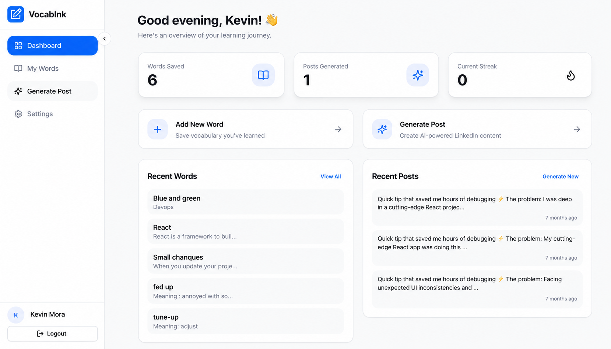
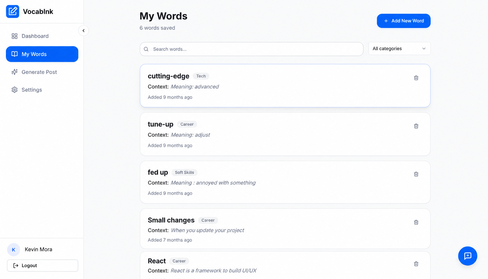
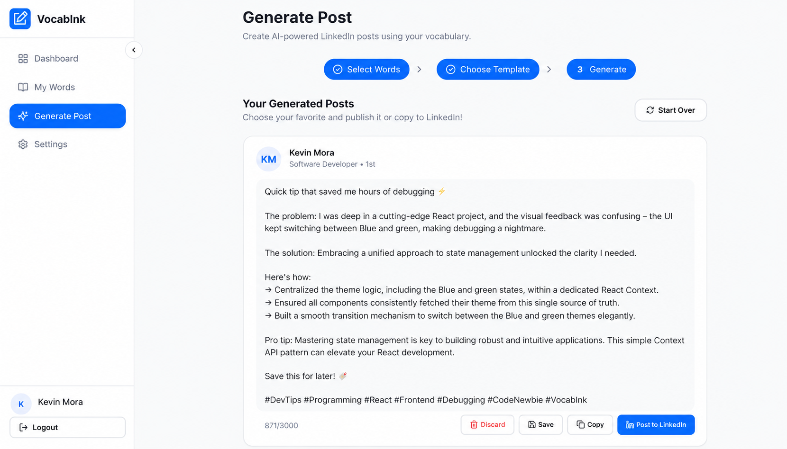

# VocabInk — Frontend

**Grow your vocabulary. Turn what you learn into content worth sharing.**

VocabInk is a personal vocabulary builder and AI-powered content creation assistant for developers and professionals. Save new words, organize your personal dictionary, and create LinkedIn posts that put your learning into practice.

This repository contains the **React and TypeScript frontend**: the user interface, navigation, state management, and integration with a separate backend API. Authentication, data storage, AI generation, and LinkedIn publishing are provided by that backend.

## Screenshots

### Learning dashboard



### Personal vocabulary



### AI-assisted post creation



## Features

- **Personal vocabulary:** add, edit, and remove words; organize them by category and keep context for later use.
- **AI-assisted writing:** select vocabulary and templates to request LinkedIn post drafts from the backend.
- **Draft management:** review, save, copy, and delete generated content.
- **Learning dashboard:** view saved-word totals, published-post counts, and recent vocabulary and posts.
- **Account flow:** Google sign-in, personalized onboarding, protected routes, and account settings.
- **LinkedIn integration:** connect an account and publish through the backend integration.
- **Responsive interface:** shared layouts, Radix/shadcn UI components, and Framer Motion animations.
- **Localization:** English and Spanish interface text.

The dashboard includes a streak card, but its value currently stays at zero; live streak tracking is not implemented. There is no offline demo or bundled backend. The sign-in screen can be viewed without the backend, while authenticated features require it.

## Frontend stack

| Area | Technology |
| --- | --- |
| Framework and tooling | React 18, Vite, TypeScript |
| Styling | Tailwind CSS |
| UI components | shadcn/ui, Radix UI, Lucide icons |
| Animation | Framer Motion |
| Routing | React Router DOM |
| State | Zustand and React state |
| API integration | Axios; TanStack Query provider configured |
| Forms and validation | React Hook Form, Zod |
| Localization | i18next, react-i18next |

Most current pages request data directly through the shared Axios client. Zustand handles authentication and includes persisted vocabulary/post stores; it does not replace backend persistence for the authenticated pages.

## Getting started

Use Node.js 22 and npm. A version file is included for nvm users.

```bash
git clone <repository-url> vocabink
cd vocabink
nvm use # Optional, if you use nvm
npm ci
cp .env.example .env
npm run dev
```

Open **http://localhost:8080** (or the URL printed by Vite if that port is occupied).

### Environment configuration

```dotenv
VITE_API_URL=http://localhost:3000
```

Set this to the backend origin, without adding `/api` or `/v1`: the frontend already includes `/v1` in its endpoint paths. Restart the development server after changing it.

All `VITE_` values are public browser configuration. Keep AI provider keys, OAuth client secrets, and other credentials on the backend. Local `.env` files are ignored by Git; `.env.example` is included as a safe template.

### Backend integration

The frontend expects a compatible API for authentication, onboarding, vocabulary categories, vocabulary, system templates, posts, and LinkedIn actions. See [the API client](src/lib/api.ts), [auth store](src/stores/authStore.ts), [pages](src/pages), and [LinkedIn service](src/services/linkedinService.ts) for the request paths and payloads.

Authentication uses backend-managed cookies. The backend must allow the frontend origin with credentialed CORS and configure cookies and OAuth redirects for the environment. The frontend handles the `/auth/callback` route. Provider setup and AI generation logic are outside this repository.

## Development commands

| Command | Purpose |
| --- | --- |
| `npm run dev` | Start the Vite development server on port 8080 |
| `npm run typecheck` | Check application and Vite configuration types |
| `npm run lint` | Run ESLint |
| `npm run build` | Generate a production build in `dist/` |
| `npm run build:dev` | Build using development mode |
| `npm run preview` | Serve the build locally for inspection |

GitHub Actions runs type checking, lint, and a production build on pushes and pull requests. There is no automated test suite configured yet. ESLint currently reports warnings for hook dependencies and component exports.

## Project structure

```text
.github/workflows/      Frontend validation workflow
public/
  logo.svg              Brand mark and browser icon
  screenshots/          Product screenshots
src/
  components/
    feedback/           Feedback widget
    layout/             Navbar, sidebar, footer, dashboard layout
    ui/                 shadcn/ui primitives
  hooks/                Shared React hooks
  lib/                  Axios client and utilities
  pages/                Login, onboarding, dashboard, words, posts, settings
  services/             LinkedIn integration
  stores/               Zustand authentication, vocabulary, and post stores
  utils/                Constants and helpers
  App.tsx               Providers and guarded routes
  i18n.ts               Localization setup
  main.tsx              Application entry point
```

## Production deployment

Set `VITE_API_URL` to your production backend origin **before building**, then run `npm run build` and deploy `dist/` to a static host. Vite embeds the API URL at build time, so changing it requires a new build.

Configure the host to serve `index.html` for client-side routes such as `/dashboard` and `/auth/callback`. The current configuration assumes deployment at the domain root. GitHub Pages project sites need additional base-path and routing configuration; this repository does not include an automatic deployment workflow.

## Uploading to GitHub

Create an empty GitHub repository, then run these commands from this project directory. Replace `<repository-url>` with your repository's SSH or HTTPS URL.

```bash
git add .
git diff --cached --stat
git commit -m "Initial commit: VocabInk frontend"
git branch -M main
git remote add origin <repository-url>
git push -u origin main
```

Review the staged files before committing. Dependencies, build output, and local environment files are excluded by `.gitignore`. If an `origin` remote already exists, inspect it with `git remote -v` before configuring another.

## Contributing

Fork the repository, create a feature branch, and open a pull request describing your change. Run `npm run typecheck`, `npm run lint`, and `npm run build` before submitting. Include screenshots for interface changes.

## License

Licensed under the [MIT License](LICENSE).
